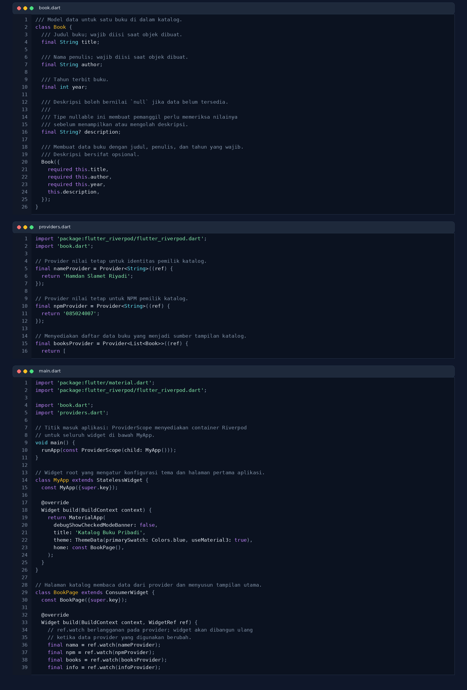
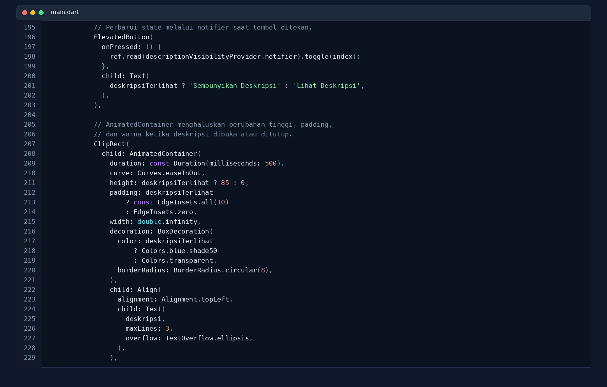
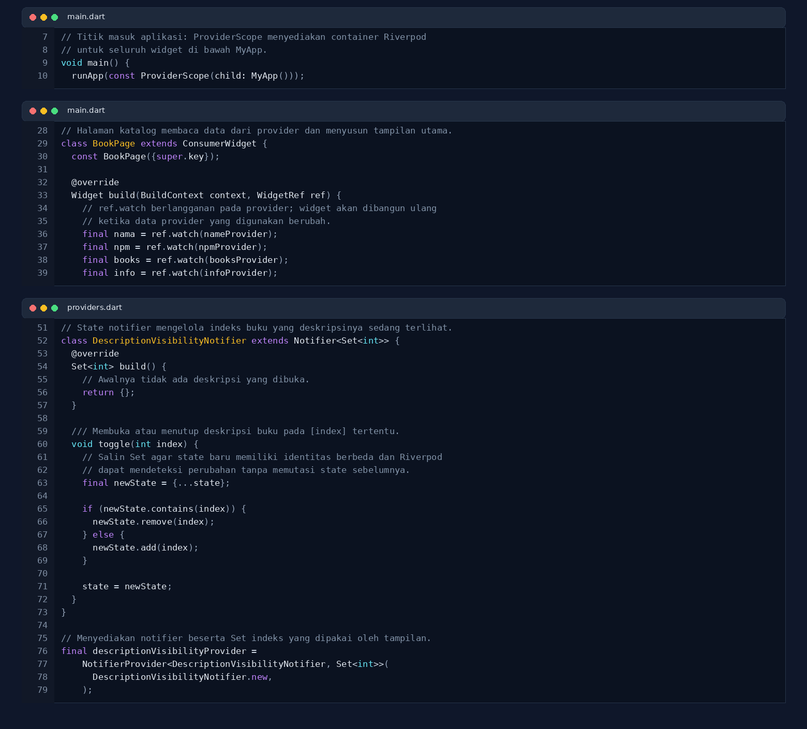
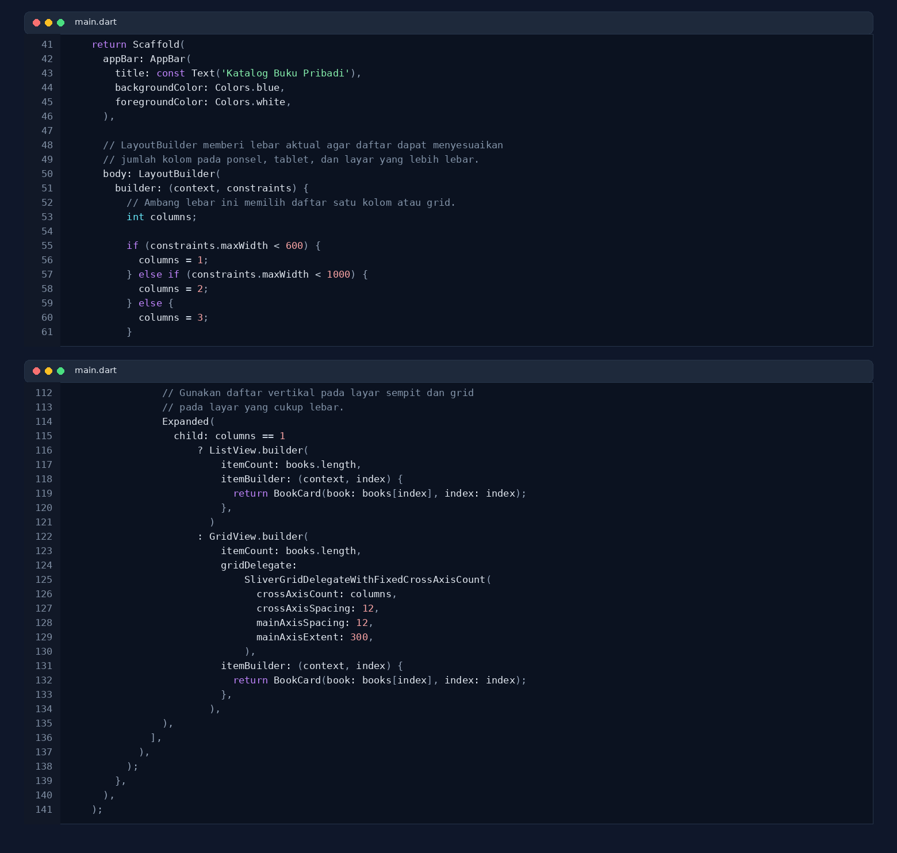
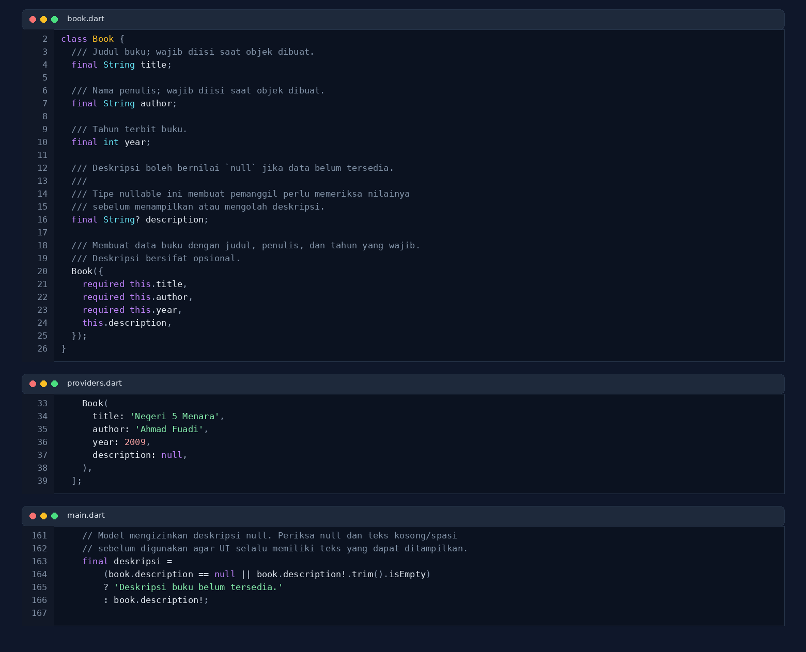

Nama : Hamdan Slamet Riyadi
Npm : 085024007

###### Katalog Buku Pribadi

Aplikasi Flutter sederhana untuk menampilkan katalog buku pribadi. Aplikasi
menyajikan informasi pemilik katalog dan daftar buku dalam tampilan yang
menyesuaikan ukuran layar.

# Fitur

- Menampilkan nama pemilik, NPM, dan jumlah buku.
- Menampilkan judul, penulis, dan tahun terbit setiap buku.
- Membuka dan menyembunyikan deskripsi buku melalui tombol dengan animasi.
- Menampilkan teks pengganti jika deskripsi tidak tersedia.
- Menyesuaikan daftar buku: satu kolom pada layar sempit, grid dua kolom pada
  layar menengah, dan grid tiga kolom pada layar lebar.
- Mengelola data katalog dan visibilitas deskripsi menggunakan Riverpod.

# Teknologi dan versi

- Flutter **3.44.2** (stable), versi yang digunakan saat dokumentasi ini dibuat.
- Dart **3.12.2** atau lebih baru sesuai batasan di `pubspec.yaml`.
- Versi aplikasi: **1.0.0+1**.
- State management: `flutter_riverpod`.

# Menjalankan aplikasi

Pastikan Flutter SDK telah terpasang dan tersedia di `PATH`, lalu jalankan
perintah berikut dari direktori proyek:

`flutter pub get`
`flutter run`

Untuk memilih perangkat tertentu, lihat perangkat yang tersedia dengan
`flutter devices`, kemudian jalankan `flutter run -d <device-id>`.

## Status fitur

# Sudah berfungsi

- Katalog menampilkan tiga data buku contoh yang didefinisikan di dalam kode.
- Tombol pada setiap kartu membuka atau menyembunyikan deskripsi buku.
- Buku tanpa deskripsi menampilkan pesan “Deskripsi buku belum tersedia.”
- Layout daftar berubah mengikuti lebar layar.
- Pengujian unit untuk model data buku tersedia dan dapat dijalankan dengan
  `flutter test`.

# Belum tersedia

- Menambah, mengubah, atau menghapus buku melalui antarmuka.
- Penyimpanan data permanen; daftar buku masih berupa data statis dan perubahan
  tidak disimpan.
- Pencarian atau penyaringan katalog.

# Menjalankan pengujian

```bash
flutter test
```

# Gambar

    


# Link video
